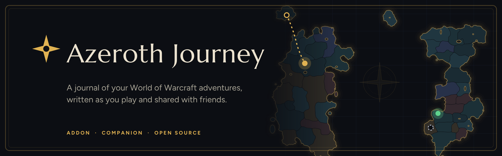
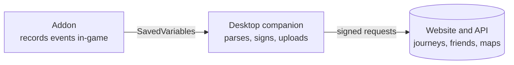

<h1 align="center"></h1>

<p align="center">
  <a href="https://github.com/azeroth-fellowship/journey/actions/workflows/ci.yml"></a>
  <a href="LICENSE"></a>
  
</p>

An adventure journal and social platform for World of Warcraft characters. A small addon records what your character
does, a desktop companion uploads it, and the website turns it into a journey you can read and share.

This repository holds the open-source parts. The website and API are operated from a separate private repository.

Website: <https://TODO-website-url.example> (placeholder, not live yet)

## How it works



## Components

| Path | What it is |
| --- | --- |
| `apps/addon` | WoW addon written in [wowlua](https://wowlua.dev/). Captures events into SavedVariables. |
| `apps/desktop` | Tauri 2 + React companion. Reads SavedVariables, signs requests with a device key kept in the OS keychain, uploads. |
| `packages/contracts` | Zod schemas and TypeScript types for every API and event shape. The source of truth, shared with the server. |
| `packages/api-client` | Typed client for the HTTP API. |
| `packages/config` | Shared `tsconfig` base. |

## Build

Needs Node 20+ and pnpm 10+.

```bash
pnpm install
pnpm build:libs     # builds contracts and api-client (the companion imports their dist/)
pnpm typecheck
pnpm test
```

Companion (also needs Rust and the [Tauri 2 prerequisites](https://v2.tauri.app/start/prerequisites/)):

```bash
cd apps/desktop
cargo install tauri-cli --version "^2"
cargo tauri dev      # talks to http://localhost:3001 unless VITE_API_URL is set
cargo tauri build
```

Addon (needs the `wowlua` CLI):

```bash
cd apps/addon
wowlua check && wowlua test
wowlua build --release
```

Releases are built by GitHub Actions from tags; see [docs/releasing.md](docs/releasing.md).

## Status

Early and honest: this is pre-release software. The targeted game is WoW Forever, which has not launched yet
(announced for 2026-11-04), so the addon has only run against wowlua's emulated client and has never run in a real game
client. The companion's installer is not Authenticode-signed, so Windows SmartScreen will warn. Linux and macOS builds
of the companion are experimental. Expect breaking changes.

## Contributing and license

See [CONTRIBUTING.md](CONTRIBUTING.md) and the [Code of Conduct](CODE_OF_CONDUCT.md). Security issues:
[SECURITY.md](SECURITY.md).

Licensed under the GNU General Public License v3.0 only (`GPL-3.0-only`), see [LICENSE](LICENSE) and
[NOTICE](NOTICE). Bundled fonts and dependencies keep their own licenses, see
[apps/desktop/THIRD_PARTY_NOTICES.md](apps/desktop/THIRD_PARTY_NOTICES.md). World of Warcraft is a trademark of
Blizzard Entertainment, Inc.; this project is not affiliated with or endorsed by Blizzard.
